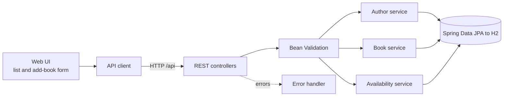
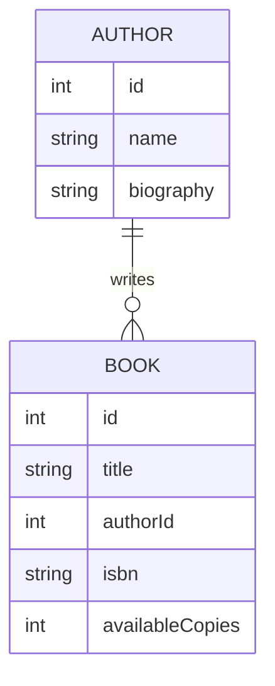

# Architecture: Book Management System

Status: Approved by user (D-004 stack, D-005 document, D-006 Design Review decisions applied). Stage 2 complete.

## Stack Decision

Approved (D-004): **Spring Boot backend with a React frontend**.

| Part | Choice |
| --- | --- |
| Language and runtime | Java 21 (LTS) |
| Backend | Spring Boot 3.x, Maven, Spring Web |
| Validation | Bean Validation (`jakarta.validation`) on request DTOs |
| Data access | Spring Data JPA with Hibernate |
| Schema | Flyway migrations |
| Database | H2 in file mode (no server install; data survives restarts, NFR-003). Migrations use portable SQL types so PostgreSQL can replace H2 later (DR-14) |
| Serving | Spring Boot serves the built React app from `/`; the API is under `/api`. Same origin, so no CORS (DR-04) |
| Error handling | `@RestControllerAdvice` |
| Frontend | React, TypeScript, Vite |
| Backend tests | JUnit 5, Mockito, Spring Boot Test with MockMvc |
| Frontend tests | Vitest, Playwright |

Options considered: Node.js + TypeScript (Express, Prisma), Python (FastAPI), .NET (ASP.NET Core). Spring Boot was chosen by the user for its Java ecosystem and growth path. PostgreSQL can replace H2 later without changing the API.

## Components

| Component | Responsibility | Requirements |
| --- | --- | --- |
| REST controllers (`/api`) | HTTP handling, request parsing, status codes | FR-001 to FR-006 |
| Validation (Bean Validation) | Checks and sanitizes request DTOs at the API boundary | NFR-001, FR-001, FR-002, FR-004 |
| Author service | Create and list authors | FR-001, FR-006 |
| Book service | Create books, check the author exists, get and list books | FR-002, FR-003, FR-005, FR-006 |
| Availability service | Set and update available copies on a book | FR-004 |
| Error handler (`@RestControllerAdvice`) | Maps errors to safe responses, no stack traces; malformed JSON to 400, unsupported media type to 415 (DR-08) | NFR-002 |
| Configuration | Port, DB file path, log level. H2 console off outside development. Binds to localhost by default (DR-05, DR-09, DR-10) | NFR-002, NFR-003 |
| Data access (Spring Data JPA) | Persists authors and books in H2; schema from Flyway | NFR-003 |
| Web UI: book list | Shows title, author, copies; updates copies | FR-009, FR-010 |
| Web UI: add-book form | Collects fields, shows validation messages, inline add of an author | FR-007, FR-008 |
| Web UI: API client | Calls the API and maps error responses to messages | FR-008, FR-009 |

## Data Model

```
Author
  id          integer, primary key
  name        text, required, 1 to 200 characters after trimming; unique, case-insensitive (DR-01)
  biography   text, optional, up to 2000 characters
  createdAt   timestamp
  updatedAt   timestamp

Book
  id               integer, primary key
  title            text, required, 1 to 300 characters
  authorId         integer, required, foreign key to Author.id
  isbn             text, optional, up to 20 characters (no format or uniqueness check, A-04)
  availableCopies  integer, required, default 0, minimum 0, maximum 1000000; database CHECK (availableCopies >= 0) (A-01, DR-06)
  createdAt        timestamp
  updatedAt        timestamp
  version          integer, starts at 0, incremented on each update (DR-03)
```

Author name uniqueness is a unique index on `lower(trim(name))` (DR-01).

Availability is the `availableCopies` column (A-01). Deleting an author is out of scope (A-05), so no cascade rule is needed.

## API Contracts

Base path: `/api`. Request and response bodies are JSON.

| Method | Path | Request | Success | Errors |
| --- | --- | --- | --- | --- |
| POST | `/authors` | `{ name, biography? }` | 201 `Author` | 400 invalid field, 409 name already exists |
| GET | `/authors` | none | 200 `Author[]` | none |
| POST | `/books` | `{ title, isbn?, availableCopies?, authorId }` or `{ title, isbn?, availableCopies?, newAuthor: { name, biography? } }`; exactly one of `authorId` or `newAuthor` | 201 `Book` (with `author: { id, name }`) | 400 invalid field, 404 author not found, 409 author name already exists |
| GET | `/books` | none | 200 `Book[]` (with `author`) | none |
| GET | `/books/{id}` | none | 200 `Book` (with `author`) | 404 book not found |
| PATCH | `/books/{id}/availability` | `{ availableCopies, version }` | 200 `Book` (new `version`) | 400 invalid value, 404 book not found, 409 stale version |

Error body (all errors): `{ "error": { "code": "VALIDATION_ERROR" | "NOT_FOUND" | "CONFLICT" | "INTERNAL_ERROR", "message": "..." } }`. Internal errors never include stack traces (NFR-002).

Validation rules are enforced in the Validation layer for every write (NFR-001). Input is trimmed, blank values are rejected, and text is stored as plain text (DR-07).

## Interactions

1. When the user adds a new author inline, the UI sends one `POST /api/books` with `newAuthor`. The book and its author are created in one transaction, so a failed save leaves no orphan author (DR-02).
2. The UI loads `GET /api/books` to show the list. Each row's copies control sends `PATCH /api/books/{id}/availability` with the `version` it last read. A stale version returns 409, and the UI reloads the row (DR-03).
3. The controllers validate the request DTOs, call the service, and the service uses Spring Data JPA to read or write H2.
4. Errors flow back through the `@RestControllerAdvice` error handler, which returns a safe body. The UI shows the message next to the field or as a notice.



## Diagrams

Component and data flow is shown above. Entity relationship:



## Requirement Traceability

| Requirement | Satisfied by |
| --- | --- |
| FR-001 | Author service; `POST /authors` |
| FR-002 | Book service; `POST /books` |
| FR-003 | Book service author check; 404 from `POST /books` |
| FR-004 | Availability service; `PATCH /books/{id}/availability`; `availableCopies` |
| FR-005 | Book service; `GET /books/{id}` |
| FR-006 | Author service and Book service; `GET /authors`, `GET /books` |
| FR-007 | Web UI add-book form |
| FR-008 | Web UI add-book form; API client error mapping |
| FR-009 | Web UI book list |
| FR-010 | Web UI book list copies control; availability endpoint |
| NFR-001 | Validation layer |
| NFR-002 | Error handler |
| NFR-003 | H2 file database with Flyway migrations |
| NFR-004 | Web UI form controls with labels (accessibility check in Verification) |
| NFR-005 | JUnit 5 and MockMvc tests (backend); Vitest and Playwright tests (frontend) |

## Design Review Decisions

Recorded in D-006 after user approval of [design-review.md](./design-review.md).

| ID | Decision | Applied in |
| --- | --- | --- |
| DR-01 | Author names unique, case-insensitive; 409 on duplicate | Data Model, API Contracts |
| DR-02 | One `POST /books` can create the author in one transaction | API Contracts, Interactions |
| DR-03 | Optimistic locking with `version`; 409 on stale update | Data Model, API Contracts, Interactions |
| DR-04 | Spring Boot serves the React build; no CORS | Stack Decision |
| DR-05 | Bind to localhost; no authentication is an accepted risk | Assumptions |
| DR-06 to DR-14 | Applied as recommended (checks, input rules, error codes, config, nested author shape, `updatedAt`, portable SQL) | Stack, Components, Data Model, API Contracts |

## Assumptions

- The stack is approved (D-004). Approval of this document confirms the design.
- The H2 database file lives on local disk. No hosting or multi-user deployment is in scope.
- Accepted risk (DR-05): no authentication. The app binds to localhost only. Any change in exposure needs a new review.
